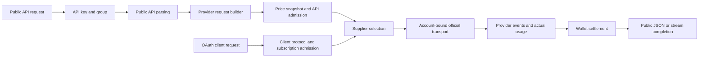

# Architecture

## Official protocol baseline

- Official repository: https://github.com/openai/codex
- Release: `0.162.1` / `rust-v0.162.1`
- Commit: `092d3acd6bec3e3a14bdc7e7a2810ab628ab759d`
- Commit time: `2026-10-09T17:39:05Z`
- Reference-only checkout: `reference/codex`; constants: `crates/codex2api-version`
- Maintained client: [gucooing/codex, ccodex](https://github.com/gucooing/codex/tree/ccodex)
- Fork integration commit: `c63e0d6140676390d687bd1389a1d36b34046821`

The maintained client inherits the exact official release. Its customizations are
`BASE_OAUTH_URL`, the `ccodex` executable, `.ccodex` default home and its release
channel. Supplier protocol constants always come from official Codex. Official
Rust crates are never dependencies of this proxy. Follow [CODEX_UPDATES.md](CODEX_UPDATES.md)
for baseline changes. Build and test both frontend exports and the Rust workspace; release packaging uses the release workflow.

Client Rust compilation, tests, schema generation and native runtime validation
remain unverified under the no-local-ccodex-compilation policy. Full `just fmt`
and Bazel lock validation are also unverified because those tools are unavailable;
the completed local client checks cover source, direct Rust formatting and static packaging.

## Process and crates

One Rust process runs four listeners: OAuth/client protocols (8080), administration (8081), the user website/API (8082), and API-key metered inference (8083). Each router registers only its own surface and credential audience. The administrator and user Next.js projects produce separate static exports embedded in the same executable. Production does not run a Node.js server.

| Crate | Responsibility |
| --- | --- |
| codex2api-core | Provider identities, entitlement rules and model price presets |
| codex2api-storage | SQLite schema, credentials, configuration, resources and request ledger |
| codex2api-accounts | Persistent supplier identity and frozen per-account HTTP fingerprint |
| codex2api-auth | Supplier OAuth, token refresh/revoke and isolated account transports |
| codex2api-upstream | Official outbound endpoints, headers, body normalization, HTTP/SSE/WS |
| codex2api-service | Shared execution authorization and effective entitlement policy |
| codex2api-scheduler | Provider-neutral supplier selection, affinity, capacity, pre-output inspection and classified failover primitives |
| codex2api-api | Consumer OAuth and independently scoped client protocol adapters |
| codex2api-gateway | Public API parsing, provider-owned official request construction, API-key admission, response conversion and wallet settlement |
| codex2api-admin | Administrator session, CSRF, typed REST contracts and operations |
| codex2api-user | User browser sessions, own API keys/catalog/usage, wallet purchases, subscriptions/devices and OAuth consent |
| codex2api-web | Embedded static assets and source freshness validation |
| codex2api-version | Exact official release and independent application release tag |
| codex2api | Startup, dependency composition, listener and graceful shutdown |

`codex2api-api` and `codex2api-gateway` both call `codex2api-scheduler`; neither
inference surface calls the other. The scheduler takes an explicit provider,
consumer identity and tag set, and never authenticates OAuth or API keys, reads
wallets, or decides subscription benefits. The caller supplies revalidation for
waits and retries. Existing OAuth subscription admission remains in
`codex2api-service`; metered API admission and settlement use independent API
records and the ordinary user's wallet. Administrator and user HTTP modules
receive only a read-only current-concurrency callback, not gateway execution
capabilities. API product configuration and public DTO contracts are described in
[Metered API](API.md).

Incoming routes are explicit in `codex2api-api/src/providers/chatgpt/routes.rs` and
the resource modules under `codex2api-admin/src/rest/` and `codex2api-user/src/rest/`.
Each administrator business resource owns its router and handlers in one module.
Plans, models, users and subscriptions have separate business modules; identical
platform-account operations share one module instead of duplicating their handlers.
The root routers assemble these resources and apply session and account-scope
middleware. Users and their subscriptions have separate namespace routers;
only identical platform-resource operations share handlers. Handlers adapt requests to services; they do not
derive routes from outbound endpoint enums. Gateway provider adapters own the
conversion from public API semantics to official client bodies and request-scoped
headers. Auth/upstream own supplier credentials, frozen fingerprints, account-bound
normalization and network transport. SQLite code neither calls providers nor
registers HTTP routes.

## API gateway and OAuth client surfaces

The two inference listeners have different contracts. The OAuth/client listener
accepts the corresponding client's protocol, checks its account and subscription,
and preserves conversation contents, protocol events and client request IDs while
normalizing supplier identity. The API-key listener accepts public Responses,
Chat Completions and image APIs and constructs a new official-client request.
OAuth identifies a consumer on one listener and supplies upstream credentials;
it is not the API gateway's request-adaptation strategy.

`gateway/request.rs` separates caller response preferences from inference input,
validates public controls and separates local metadata from upstream input. It
neither selects a supplier nor supplies credentials. Provider adapters convert
protocol semantics without dropping opaque tool or multimodal payloads.
`PreparedRequest` carries the provider body, validated dynamic headers, local
response metadata, upstream operation and downstream output mode.

ChatGPT converts Chat messages, tools and results to the pinned Codex Responses
shape. Its upstream request uses `stream=true` and `store=false`; API callers may
still choose JSON or SSE. The adapter preserves supplied session/thread/window metadata and headers
without deriving new caller identities from suppliers or API keys. Grok independently builds its Responses or Chat request,
including its own parameter names, reasoning replay shape and stream options.
Image JSON and multipart inputs go through the corresponding provider builder.
Protocol conversion preserves the native tool, multimodal and replay payloads;
provider validation remains authoritative for unsupported extensions. Search,
compaction and input counting use their own real upstream wire contracts.
[Metered API](API.md) documents these operations and their actual boundaries.

The selected supplier contributes credentials, installation ID, frozen HTTP
fingerprint and outbound proxy only in the official transport. Caller API keys,
cookies, account selectors, `client_metadata` and privileged client flags cannot
select or impersonate that identity. Request IDs remain fixed across retries of one API execution. Header values used to derive local affinity are not
thereby authorized for upstream forwarding.

All OAuth and API-key requests use `usage_records`, the same insert/finalization
functions, failure fields, queries and statistics. The ledger stores `error_code`
and administrator-only `error_message`; `http_status` describes the transport.
It does not store `failure_kind` or `failure_status`. Provider classification and
structured client errors remain part of execution, independent of these ledger fields.
Gateway admission snapshots
model prices and group multipliers before execution. ChatGPT search uses the API
group's independently configured final per-call USD price, without a multiplier or
fallback to subscription search pricing; Grok groups cannot configure it. Wallet settlement is atomic
with shared ledger finalization; wallet-funded requests do not consume OAuth
subscription windows. Regular-user reads bind the persisted `user_id` and use an
explicit public field allowlist. Usage lists filter Api/subscription by the persisted
subject kind and display the API key name or subscription username. Wallet record
lists show order payments and system adjustments; usage charges are inspected in
usage records while the internal immutable balance ledger retains all debits.
There is no separate API usage table or endpoint. The ledger records the caller's
streaming mode independently of supplier framing. The shared HTTP response
reader identifies SSE framing across byte chunks before JSON/stream dispatch,
including absent or inaccurate Content-Type, and preserves structured failures. Group/model
limits belong to the ordinary user, not each key. The shared scheduler only
reserves provider-scoped supplier capacity. Live revalidation protects revoked
keys, disabled users/groups and changed group policy during waits and retries.
Actual upstream usage drives the idempotent wallet settlement; API response
conversion never invents usage or substitutes a successful completion for an
upstream failure. HTTP and native ChatGPT WebSocket generations share admission and ledger
finalization; terminal output is released after settlement. Accepted work
continues to account for usage when the downstream disconnects.

## Storage and supplier isolation

The default database is `data/codex2api.sqlite`. SQLx applies forward migrations.
Applied SQL remains immutable and uses LF, because migration checksums cover raw
bytes. Table rebuilds temporarily disable foreign keys only on a dedicated
connection that is closed after migration; normal application connections enforce
foreign keys. Never replace a live SQLite file to merge accounts or roll back code.

Each supplier has its own row, installation UUID, frozen OS/architecture/terminal,
HTTP fingerprint, tokens, cookie jar, HTTP clients and session state. There are no
per-supplier CODEX_HOME files. Upgrades update only version-derived UA values via
`align_user_agents`; they do not regenerate identity or read the proxy host as
the account's device.

Supplier ownership is `(provider_id, chatgpt_account_id, chatgpt_user_id)`.
A workspace can have several users, and one user can have several workspaces.
The workspace-scoped account-user membership claim is a separate value. Re-login
and refresh must preserve owner identity; missing user identity does not fall back
to email or workspace-only merging. Supplier IDs, credentials, routing revisions,
quota snapshots and historical attribution survive upgrades.

User login identities live in `accounts` and `users`. `platform_accounts` stores independently owned subscription identities, with a nonunique `(user_id, provider_id)` index. A user starts with no subscriptions and can hold several on one platform. Each subscription isolates client state, OAuth devices, usage, spending windows and request limits. Standalone virtual-user identities and their data are removed by SQL migration; ordinary-user wallet, order and usage history remains intact.

A consumer's provider is fixed at creation; execution routes select
only pools of that provider. ChatGPT and Grok have independent protocol adapters.
See [Grok](GROK.md) for its authentication, model and client contracts.

## Supplier pools and runtime state

`execution_routes` stores only a pool tag and revision, never a fixed supplier.
Each generation filters enabled, authorized suppliers by the requested model and
observed availability before scheduling. Supplier model lists live in
`supplier_models`, separately from the administrator billing catalog. A supplier
with no configured models cannot serve generation requests. Discovery replaces
only that supplier's upstream entries and preserves its custom entries. Custom
models can be selected from the same provider's billing catalog or entered by name.
Batch replacement validates a single provider and atomically replaces both upstream
and custom entries with the chosen custom list. These operations never change
catalog enablement or prices, and batch replacement never requests upstream discovery.
Migration retains existing Grok discoveries in this common supplier list; ChatGPT
suppliers need an explicit discovery or custom selection.

Administrator JSON exports contain supplier identities, frozen fingerprints,
credentials, model lists, scheduling and tag names. Proxy URLs, authentication and
bindings are included only when selected. Exports offer native and Sub2api formats;
Sub2api exports map credentials and model names to its OAuth account fields and
deduplicate proxies using its `proxy_key` references. Native imports restore the exported
fields; Sub2api imports read `accounts` and `proxies` from its data export and accept
OpenAI OAuth and Grok OAuth accounts. Unsupported platforms and credential types
are skipped. Sub2api accounts receive independent local fingerprints; their explicit
model-mapping targets become supplier models, without inventing a catalog when no
mapping was exported. Each imported account and its proxy binding are saved in one
transaction. Identical proxy URLs are reused. Existing supplier identities are
skipped, preserving newer credentials, frozen identity and administrator state.
Import results display account emails as names alongside outcomes, never credential values.

Session affinity stores an account ID with a TTL. The Redis key includes the
provider, pool tag, consumer identity and session hash so ownership remains
isolated. New selections use `SET`; successful reuse conditionally renews the same
value with `EXPIRE`. Invalid mappings are conditionally deleted. ChatGPT uses
session headers, `prompt_cache_key`, then a model/system/tools/first-user content
seed. Grok inserts `X-Grok-Conv-Id` before the cache key and a valid `resp_*`
previous-response seed before content, then hashes
`grok-affinity:v1:<model>:<seed>`. Switching Grok models produces separate affinity.
Only hashes and account IDs are retained, never conversation contents.

The default advanced scheduler scores normalized priority, load, queue, error
EWMA and first-token-latency EWMA with weights `1, 1, 0.7, 0.8, 0.5`. Lower
priority numbers are preferred. Load is the floored percentage of active plus
waiting requests over positive `load_factor`, otherwise positive concurrency,
otherwise one; this denominator never changes the actual slot limit. Equal
priorities score one and missing/equal latency scores 0.5. EWMA uses 0.8 of the old
value and 0.2 of each completed attempt; the first valid latency initializes it.
Optional sticky weighting adds three for the session owner and five for a movable
previous-response owner. The top seven candidates are considered by default;
a qualifying previous owner, then session owner, leads the order, otherwise a
seeded weighted selection uses `score - minimum + 1`. Model-pool indexes retain
ordered ready accounts and consume a bounded log of changed supplier metrics.
Acquisition updates the local count before releasing the index lock. Normal
requests update changed accounts and take Top-K from the index rather than
scoring the whole pool. A change to normalization extrema rebuilds scores;
retry exclusions use the remaining population. The traditional option groups under-capacity
candidates by priority, load and least-recent use, breaking ties by the session
seed; unlimited suppliers remain eligible even above the load denominator.

Hard affinity is the default. A provider-and-pool snapshot expands each model to
its eligible account references and indexes account membership separately. Both
channels share this index. Affinity looks up the bound account without scanning
the candidate list or reading every supplier's load. A healthy owner is reused and renewed. Busy owners
can wait for the configured timeout (default ten seconds); with escape enabled,
busy or unhealthy owners (error EWMA at least 0.5 or latency at least fifteen
seconds) allow a different candidate while preserving the original session
mapping. An unmigratable `previous_response_id` requires its original supplier,
including after reconnecting; a missing or unavailable owner returns
`supplier_context_required`. Known full WS context permits safe supplier changes.

`CODEX2API_REDIS_URL` is required. Redis owns affinity, response ownership, rolling
RPM and renewable concurrency leases. Missing configuration or a failed initial
connection prevents startup; no local substitute is used. `CODEX2API_REDIS_PREFIX` isolates
independent deployments sharing a Redis database; the default hashes the absolute
SQLite path. In containers with the same internal SQLite path, explicitly use
different prefixes for independent installations. A configured Redis outage fails
new admissions closed. Response ownership is written before completion reaches
the client. Concurrency leases last ninety seconds and
renew every twenty seconds; release and expiry cover both normal completion and
process loss. A local slot guard also prevents a Redis restart from admitting
more than the single process's configured capacity.

SQLite remains authoritative for identity, credentials, entitlements, model
configuration and immutable accounting. Shared scheduling, model catalogs,
supplier model membership, frozen transport fields and price snapshots use
bounded native in-process caches. Immutable lists are shared through `Arc`;
each candidate pool owns its scheduling index, so replacing a pool releases the
old index when its last reader finishes. Multi-tag unions use stable provider,
tag-set and model keys and weak source references; changed sources replace the
same cache entry without retaining old source pools. Cache reads do not
encode/decode JSON. Concurrent misses for one key share a
loader, cancellation releases that loader, and generation fencing prevents a
pre-edit read from repopulating an invalidated cache. Administrator and supplier
state writes invalidate snapshots, including fingerprint edits, proxy URL changes
and unbinding. Pool snapshots expire within thirty seconds or at the earliest
pending quota reset, including empty pools. Model and account changes invalidate
the expansion before the next selection. Entitlement, route and spending
admission snapshots share the same invalidation boundary; subscription expiry
and quota reset timestamps bound their lifetime. Consumer authorization and revocation
remain live reads; the HTTP dispatcher passes the validated principal to its provider.
Admission runs before selection and carries its policy/spending/time generation
to request start; changes require revalidation. Supplier credentials and account
records are immutable snapshots invalidated by login, refresh, deletion and account edits.
Providers decode their own credentials once per snapshot. Healthy credentials
avoid the refresh lock; refresh and rejected-token recovery recheck after locking.
Workspace routes reuse the persisted snapshot and parsed route; discovery locks
only cache misses and explicit refresh. Account client caches have independent
construction locks, preserving isolated clients, cookies and refresh locks.
Targeted routing/profile updates invalidate only their own key and fence stale fills.
Local capacity
waiters wake on permit release; Redis-backed waits also poll for remote releases.
Scheduling, RPM and
slot acquisition take no SQLite write lock. Last-used timestamp writes coalesce
for sixty seconds. Generation admission reads cached eligibility and pricing
availability for tokens, images and per-operation charges, not usage details.
Settlement invalidates the owner's spending
decision; first use also updates the optional inner-window anchor. Cache misses
aggregate indexed amounts in SQLite instead of fetching every ledger row into
Rust. Protocol quota fields reuse that snapshot; lifetime totals belong to
administration and statistics. Request start, completion, retry attribution, activity,
device/supplier touches, routing and passive supplier quota observations use one bounded writer, batching immediately
available work into durable transactions. Acknowledgements and cache updates
follow commit. Request prices remain immutable and duplicate completions do not
charge twice.

OAuth/client request metadata and forwarding reuse the decoded HTTP body. Its
Grok execution path serializes the normalized body once and shares encoded bytes
across supplier attempts. The API gateway separately builds `PreparedRequest`;
its encoding and preparation costs must be assessed on that path rather than
inferred from the OAuth implementation. ChatGPT normalizes the parsed body for
the chosen account and preserves official compression. WebSocket accounting, error classification and output sanitization
share parsed events. Queued WebSocket requests retain the parsed value and byte count;
dequeue and ledger validation do not decode the frame again. SSE framing scans newly received bytes and splits buffers
without moving the remaining stream. Complete lines feed the shared SSE parser,
avoiding repeated scans of partial lines. ChatGPT preserves unchanged frames;
Grok preserves unchanged JSON while retaining its event framing.
Sanitization reports changes directly instead of cloning whole events to compare.
Both providers use the shared scheduler and snapshot store; their wire adapters,
credentials and account-local HTTP clients remain provider-owned.

## Upstream identity and transport

The supplier UA formula is
`codex_cli_rs/0.162.1 ({os_type} {os_version}; {arch}) {terminal_token}`.
Official headers include `originator`, `User-Agent`, bearer authorization,
`ChatGPT-Account-ID` and `x-codex-installation-id`; request-specific session,
thread, turn and request IDs retain their actual lifecycle.

User-Agent, the provider `version` header and catalog `client_version` share the
pinned release version. Startup aligns only the ChatGPT supplier UA strings in
`supplier_accounts.user_agent` and `http_fingerprint_json` before creating account
transports. It preserves installation IDs, OS, architecture, terminal, proxy,
timezone and unknown fingerprint fields, and leaves other providers unchanged.

OAuth uses `https://auth.openai.com`, client ID
`app_EMoamEEZ73f0CkXaXp7hrann`, and the pinned official scopes.
Responses uses `https://chatgpt.com/backend-api/codex/responses`.
The OAuth/client path normalizes supplier identity while preserving input, tools,
opaque Guardian messages and client dynamic IDs. The API gateway first constructs
the official request from public API semantics, then applies the same supplier
identity binding. Both use application-layer identity, not forged TLS/JA3.

Responses serialization places `model`, `stream` and an explicitly supplied
`service_tier` before large input fields. WebSocket `response.create` places its
`type` first. This ordering does not add missing fields or alter nested payloads,
Cyber access-program selections, warmups or interrupts.

Execution supply is a provider-scoped tag pool. Suppliers may have multiple tags.
Subscriptions inherit their plan's pool unless an administrator explicitly selects
a subscription-specific pool. Selection is per generation with runtime affinity and
concurrency, as described above; it never counts or persists fixed assignments.
Referenced tags cannot be deleted. Existing migrated tags are retained.

Supplier tag definitions are managed on their own administrator page. Account
detail and list batch editing submit a complete checked tag set, limited to the
suppliers' provider. `POST /admin/api/suppliers/tags` requires `account_ids` and
`tag_ids`: replacement is atomic, an explicit empty set clears memberships, and
omitted fields cannot clear tags. Unselected suppliers and other account fields
remain unchanged. Only edited selections are submitted.

Supplier availability separates manual disablement, permanent credential rejection,
billing rejection and quota exhaustion. The administrator `enabled` flag controls
intent only; it can be changed in every availability state. Successful explicit
reauthorization clears prior failure state in the same transaction as credentials,
starts a new credential revision even for identical tokens, preserves manual
disablement and frozen identity, and invalidates supplier eligibility caches. No manual
authorization-recovery endpoint or button exists. Token refresh uses a revision
check, cannot overwrite a concurrent login, and preserves billing and manual state.
Ordinary request throttling remains a client retry concern.
The ChatGPT adapter follows
`codex-api/src/api_bridge.rs`, `sse/responses_error.rs` and
`login/src/auth/manager.rs` in the pinned reference: `usage_limit_reached` and known
quota/credit codes indicate exhaustion. `rate_limit_exceeded`, `slow_down` and
unclassified HTTP 429 are forwarded with their retry information; they never
change supplier health or affinity and are excluded from error EWMA samples. 403, network failures, policy errors
and 5xx never permanently invalidate credentials. Refresh rejection follows the
official permanent codes, including HTTP 400 `invalid_grant`; expired access tokens
are refreshed before abandoning their supplier. Observations carry credential
revisions so stale failures cannot disable newly replaced authorization.

ChatGPT HTTP 402 `Payment Required`, including responses without a structured
error code, records a persistent billing rejection and removes that supplier from
the pool. `detail.code` is preserved when supplied. This rejection does not delete
credentials or invoke authorization recovery, has no automatic expiry, and is not
cleared by successful quota reads or ordinary token refresh. Explicit successful
reauthorization or the administrator state-reset operation clears it. Grok does not
inherit this ChatGPT-specific classification.

Quota cooldowns persist in SQLite and expire automatically at the official reset or
Retry-After time. When timing is absent, a sixty-second retry cooldown is used;
it is not presented as an official quota reset. Fresh main quota responses can
also record exhaustion; model-specific additional windows do not disable the whole
account. A fresh ChatGPT response explicitly allowing execution or reporting usable
credits clears quota exhaustion immediately, even before the old reset time, and
invalidates pool eligibility caches. Unknown, failed or cached reads never prove recovery.
Credential and quota observation revisions protect against late checks, including
checks started before an administrator reset.

The process runs a ChatGPT recovery sweep at startup and waits ten minutes after
each sweep. It probes only currently quota-exhausted, enabled, authorized suppliers
with current credentials, at most four concurrently; healthy, disabled, rejected, billing-blocked
and already-expired cooldowns are excluded. It shares account clients, per-account
cache locks and concurrent fresh observations with administrator checks. Failures
use ChatGPT execution's normal authentication refresh/retry and supplier failure classification:
permanent authorization rejection marks the credentials invalid, explicit exhaustion
updates cooldowns, and transient transport/service failures do not disable accounts.
Failed reads preserve the last quota snapshot; no separate probe failure counter is used.
These wire-error and authentication rules remain in the ChatGPT adapter and are
never applied to Grok or another provider.
No browser is needed.
The worker is cancelled before storage closes. Supplier lists use only the SQLite
snapshots included in the list DTO, including stale or missing snapshots. They do
not call quota endpoints and have no refresh button or batch quota refresh. Query,
view changes and UI timer ticks never call the provider. Explicit official refresh
remains available on the account detail page.

Administrator `POST /admin/api/suppliers/{id}/reset-state` provides an offline retry
through the list's **More / Reset state** action. It clears quota cooldowns and billing rejection,
invalidates in-flight quota observation revisions and pool eligibility caches; manual
disablement, authorization rejection, credentials and official snapshots remain
intact. A subsequent explicit upstream exhaustion can mark the account again.

HTTP Responses and Responses WebSocket internally try each eligible pool member
at most once for unrecoverable authorization, explicit quota exhaustion or ChatGPT billing rejection.
Authentication recovery remains bounded.
SSE and WS buffer the small pre-generation prelude so a rejected attempt does not
leak its error/response ID into the client's successful generation. Prices and RPM
admission are captured once; only the winning attempt's reported usage settles the
request. Exhausted pools return a service `supplier_pool_exhausted` error rather
than the supplier's login or quota error.

Once response output or a tool event has been released, the generation cannot be
replayed safely. Network interruption, malformed streams and post-output failures
retain structured errors and close behavior; subsequent requests select a healthy
member. Responses WS serializes queued generations, rechecks credentials and policy,
and can reconnect supply between generations without replacing the virtual device.
Its in-memory conversation input/output permits replay of known previous-response
references on a new supplier. A previous-response reference without reconstructible context stays on its recorded
supplier; if that supplier is unavailable the client must resend full input
(`supplier_context_required`). Supplier-owned cloud tasks and conversations keep
their recorded source, subject to current pool eligibility and ownership checks.
They are never replayed on another supplier. Voice calls are unavailable: all
Realtime/Live creation, WebSocket and sideband aliases reject with HTTP 501
`voice_calls_unavailable` before supplier selection. Voice catalogs and selection
are disabled; user settings publish `voice_enabled=false`. Independent dictation
is unchanged.

## Subscription client data and management

### Ownership and subscription policy

Server-owned identity, catalog, billing, subscriptions, feature availability and
announcements are editable in administration. Client-owned sessions, projects,
pins, preferences, approvals, onboarding, installation state and operation history
are read-only in administration; normal client writes remain supported.
Mixed responses separate service flags from client preferences. Protocol fields
and identifiers are generated in code, not entered through arbitrary field editors.

Private data and settings belong to the virtual account in SQLite. Pool selection
authorizes execution without inheriting supplier private data, usage, tasks, profile
or quotas. Account/resource IDs in paths, queries and bodies must pass ownership
checks. Pool changes preserve virtual identity, configuration and historical records.

Subscriptions are issued by administrators or purchased with the owner's wallet.
Every grant or new purchase creates an independent platform identity. Renewals and
plan changes explicitly identify an owned subscription. Expiration ends its
execution benefits while retaining the assigned plan and historical records.
There is no implicit Free identity, Free plan or expiration fallback. Model access
still distinguishes all enabled models, a selected list and no models.

Management uses named fields and choices. Actual activity, requests, device
authorizations and resource operations are viewable as records; they cannot be
manufactured with configuration forms. Empty results are valid only after querying
an implemented data source and finding no records.

### Login identity and data boundaries

`accounts` is the single login-identity table: immutable ID and account_type
(admin/user), username, password hash, enabled state and timestamps.
`admin_users.account_id` references an administrator account; `users.id` references
a user account and owns profile, wallet and revision data. SQL constraints/triggers
reject cross-role profiles and identity/type changes. Usernames are unique within
each account type, and each login endpoint always specifies its own type.

`admin_identities` and `user_identities` join only their corresponding role.
`platform_principals` resolves credentials through the subscription's owning user.
`regular_users` and `regular_platforms` are fixed scope views. Administrator
`/users/{id}` and `/subscriptions/{id}` routes install the shared account-scope
middleware; transactions enforce the same ownership guard. Subscription IDs
cannot be substituted for user IDs or reassigned to another owner or provider.
Credential changes revoke all devices and pending authorizations owned by that
user; disabling or deleting one subscription affects only that subscription.
The removed `/consumers` administrator namespace has no compatibility routes.

SQL migration removes standalone virtual users, their platforms, credentials,
resources, configuration, usage and batch-operation history. Implicit Free
platforms and the Free plan catalog disappear. Ordinary-user usage, wallet and
order history is retained. Historical price periods carry an explicit `user_id`
even after an implicit identity or administered subscription is deleted.
The user HTTP crate receives `UserStore`, a narrow repository with no raw SQL,
supplier or administrator access. Response DTOs explicitly select user-visible
fields; common signing primitives do not create a shared HTTP login/data endpoint.

### User wallet and subscription transactions

User creation does not create platform identities. A grant or new purchase creates one subscription. Expired subscriptions remain inspectable without acquiring fallback benefits.

Subscriptions inherit the assigned plan's supplier pool unless administration
sets an explicit pool override. `regular_subscription_pools` and
`effective_execution_routes` resolve that choice in SQLite. Clearing the override
restores plan inheritance. The administration route is
`/subscriptions/{id}/routing`; user APIs never expose supplier routing.
Pool edits preserve identity, expiration, spending anchors and price snapshots.

Wallet balance is `users.wallet_cents`, with a nonnegative integer constraint. It starts at zero. Identity forms and user APIs cannot set it. Administrators use `/admin/api/users/{id}/wallet-adjustments` with a signed-in administrator session, CSRF, expected user identity revision, idempotency key, signed integer-cent delta and optional reason. Missing, null and blank reasons normalize to null; nonempty reasons retain their length limit. A single immediate transaction applies the delta and appends a `system_adjustment` ledger entry containing the operator snapshot and before/after balances. The identity revision changes only when user identity/profile data changes; usage charges, debt settlement, order payments and administrative wallet adjustments leave it unchanged. Relative adjustments apply to the transaction's current balance, so intervening wallet movements do not cause a revision conflict. Overdraw, spending already reserved for measured API debt, unsafe amounts and stale identity revisions are rejected. The frontend shows only an estimated balance and leaves balance validation to the transaction. Replays return the same entry without another balance change. Ledger updates/deletions are prohibited; historical purchase entries remain intact. The administrator-only `GET /admin/api/wallet-entries` reads all users' ledger entries with exact user ID, source, optional Unix-millisecond start/end bounds and pagination. The count and rows share a read transaction, timestamps are compared as instants, and ordering breaks time ties by insertion order. List DTOs add only the owner username/name to ledger fields, including the original order reference. This capability is not exposed through UserStore or the user listener. User wallet DTOs show the change as a system operation without administrator identity or private reason. There is no external payment integration; checkout offers the USD wallet. Plan sale price uses at most two decimal USD places, separately from model-priced inference budgets. Plans have a purchase duration and an administrator-only supplier pool. User catalog publication and purchase require both `virtual_plans.allow_purchase` and an explicitly configured sale price. Unpriced or closed plans are absent from catalog rows and totals; unknown prices are never zero. An explicit zero price is configured pricing. Supplier execution configuration does not gate wallet checkout or payment. Closing purchases blocks user purchases/renewals, not administrator assignments or existing benefits. No Free plan is provisioned.

`POST /user/api/checkout/preview` computes an unpersisted, five-minute quote with plan, effective period, current-subscription credit, coupon discount and payable amount. It never creates an order, reserves a coupon or debits the wallet. A short-lived RS256 proof binds the authenticated owner, selection, exact optional target subscription ID, pricing instant and quote digest to `checkout_preview` / `codex2api-checkout` under the user signing key. It cannot authenticate a web session or Codex client. No supplier configuration is in the proof or response.

Only explicit confirmation calls `POST /user/api/orders` with that proof. Inside `BEGIN IMMEDIATE`, it recomputes the signed quote at its original pricing instant, validates current plan/subscription/coupon revisions and capacity, and creates the order. The proof ID is the owner-scoped idempotency key. Coupon eligibility and remaining-subscription expiry can shorten the original deadline; confirmation never extends it. Client amounts and owner selectors are not accepted. Order views explicitly select business fields.

Payment is a separate `/orders/{id}/pay` operation. It checks ownership, enabled state, deadline, configured price, plan publication/revision and subscription revision. The debit, entitlement update, price-period snapshot, unique order-linked wallet entry and paid state commit together. Replaying a paid order returns its existing result. Competing changes to the same subscription cannot both settle from one revision. Independent new-purchase orders create different subscriptions and may both settle. Plan changes, closed sales, changed/disabled subscriptions and expiry have distinct messages; cancelled orders retain their reason. Insufficient balance leaves the order pending, with no debit or entitlement mutation. Infrastructure failures are logged privately and return a generic retry message without database or supplier detail. Paid orders are immutable.

Coupons are administrator-owned fixed-cent discounts with optional plan scope, minimum subtotal after subscription credit, validity dates, global capacity and a per-user limit. Previews do not reserve capacity. Confirmation reserves by creating a live pending order under the same write lock; cancellation/expiry release it, and payment consumes it. Confirmed orders keep the coupon code and discount snapshot despite later coupon edits or disabling. Coupon records cannot be deleted through the API. Discount is capped at the nonnegative subtotal; zero-price orders still require both confirmation and explicit payment. `amount_cents` is generated from the stored subtotal minus discount.

New purchases start their full duration on payment. Same-plan renewal extends from
the existing expiry and preserves the spending-window anchor. Active plan changes
compare the target daily sale price with the current period's original price snapshot;
only a strictly higher daily price is an upgrade. Lower/equal-price changes wait until
expiration, when an ordinary purchase starts a new period. Infinite subscriptions
cannot be prorated and require administrator management.

Upgrade quotes calculate the target daily price times remaining time, less the
remaining value of each originally granted/purchased/renewed price period. Integer
arithmetic rounds each invoice line half up to a USD cent; payable amounts cannot
be negative and do not create a refund/funding entry. The checkout shows gross cost,
credit, payable amount and quote expiry before confirmation. Upgrades keep the
original expiration and spending anchor, applying the target model/budget policy and
execution route. `subscription_pricing_periods` preserves nominal price and duration
snapshots, including administrator-issued periods; subsequent price edits cannot
reprice those credits. Nominal prices determine upgrade rank; separate immutable credit-value/duration snapshots preserve the value after coupon discounts. Coupons never increase future credit value. Renewed periods retain their own prices. Administrator grants
are not fabricated orders or wallet payments. Missing historical price snapshots or
unpriced grants are explicitly unavailable for proration, never treated as zero;
the administrator can explicitly reissue the subscription at the current price to
establish a new snapshot and spending anchor. Ordinary enable/disable edits preserve
the original pricing; this reissue action is separate and never debits a wallet. Existing wallet entries
remain historical records without invented orders.

User interfaces are `/checkout/preview`, `/orders` (list/confirm), `/orders/{id}` (detail), and
`/orders/{id}/pay` or `/cancel` under `/user/api`. Administration has its own read and
pending-cancellation endpoints under `/admin/api/orders`; no shared authentication
or user-supplied owner selector is used. Order lists are paginated and filtered by order number, plan ID, and status; administrator routes additionally accept an exact user ID. User routes reject owner selectors. `/orders/plans` returns only distinct plans present in that caller's order scope, retaining historical names after sales close or catalog removal. The retired direct-purchase endpoint is not mounted. Coupon management has its own administrator-only `/admin/api/coupons` endpoints. There is no user coupon-list or coupon-management interface.

User `/usage` statistics, daily aggregation and paginated records each restrict `subject_kind` and join subscription ownership to the authenticated user; query parameters cannot select a different owner or supplier. Explicit record fields exclude supplier IDs/names, upstream request IDs, raw error messages, routing and credentials. Persisted `error_code` is included for the user's own failed requests, without returning administrator diagnostics or mapped failure categories. The user dashboard shows current subscriptions, local spending windows and real usage trends. The usage detail page contains filters, numeric summaries and paginated records, without duplicate charts. Date bucketing groups the signed timezone offset as an SQL expression, including negative offsets; an empty ledger returns zero request counts and empty rows without errors. Empty dates are zero-filled only after a successful query; missing token/cost measurements stay unknown with missing counts. Model-priced USD costs consume subscription budgets, not the wallet. Codex client usage response schemas remain unchanged.

Subscription administration uses a User column, account/expiry/status filters, quota summaries, batch operations and a Manage action. The detail page contains subscription settings, usage, reset cards, records and devices. Identity credentials are edited only in user management; subscription forms select the owner without creating another login.

### Request admission and subscription names

RPM is a per-subscription sliding sixty-second window across devices and HTTP/WS,
admitted atomically in Redis. Plans default to 40
RPM and 10 concurrent generations. Subscription overrides inherit the plan when
unset; zero explicitly means unlimited. Gateway settings have no RPM/concurrency
defaults. Plan edits invalidate policy caches and user-facing catalogs show plan
limits while subscription views show effective limits.

Each actual generation consumes one admission. Internal supplier attempts,
warmups, reads and WebSocket handshakes do not. Slots span the complete generation,
including draining after disconnect; retries retain the subscription slot.
Rejections preserve structured 429 and retry information. Supplier capacity is
independent and retains its own configured limit. Subscriptions belonging to the
same user/provider do not share their RPM or concurrency counters.

Plan management selects the official client subscription tier independently of the
business plan name. Updating that tier atomically updates assigned accounts while
preserving subscription dates and historical records. Local plan choices exclude Free;
official supplier metadata may still report it. Other public tier names include Go, Plus, Pro 100, Pro 200, Pro 500, Business, Enterprise and Edu. Protocol
values remain canonical (`prolite`, `pro`, `promax`, etc.). Supplier display also
maps workspace/education variants to their official family name and does not expose
unknown internal values as product names. Numbered Pro labels follow the installed
Desktop's `plan-names` resource; accepted protocol variants follow the pinned
`protocol/src/account.rs`. Local plans never fabricate supplier entitlements.

### OAuth and devices

The AI API authorization entry redirects to the configured public user origin.
Browser consent and device-code approval run on the user listener. A live browser
session or temporary username/password verification proves the owning user's
identity, then the page lists that user's enabled, unexpired subscriptions for
the requested platform. A dropdown selects the exact target. No subscription
means no client login; the page links to the user center. `oauth_browser_users`
keeps the flow-scoped proof, and confirmation binds the selected subscription in
`oauth_browser_identities`. Verification alone never creates a code or device.

Administrator Settings / Public addresses stores the OAuth/client API, metered API, user and administrator HTTP(S) origins together in SQLite with a revision check. Saved values take precedence over process startup defaults without restarting. Each value explicitly supplies its scheme and optional port; reverse-proxy transport and forwarded headers never select the public scheme. OAuth discovery, Grok token issuers, both providers' authorization/device redirects and client resource/event URLs read these settings. User origin checks and website cookies use the corresponding saved website origin; UserStore exposes only the user website and metered API public addresses to the user HTTP module. Existing settings without a metered API origin use the configured startup default until the administrator saves it. Listener bindings and router isolation are unchanged.

Confirmation binds the displayed account, current password version, optional live browser session, state, exact callback and PKCE S256 challenge. Codes are single use. Browser logout invalidates unconfirmed browser-session grants; password changes or disablement invalidate the user's browser sessions, platform devices and pending authorizations. Administrators authenticate only on the administrator listener. Subscription ownership, platform, enabled state and expiration are checked again when confirming a selection.

Administrator and user **web sessions** use JWTs, with independent RSA keys in
`jwt_signing_keys`. Their endpoint selects the expected role/purpose and key domain.
Only the server's fixed RS256 algorithm is accepted; none, empty/other algorithms,
unsupported headers and unknown kid are rejected. Verification checks signature,
account_type, token_use, audience, issuer, lifetime and the live role/session record.
Web access JWTs last 15 minutes; separate refresh JWTs last 30 days and rotate on
successful renewal. Both are HttpOnly cookies with distinct role/purpose/audience
checks. Refresh uses POST on each website's `/api/session/refresh` with the same
login CSRF token; a readable CSRF cookie permits renewal after a page reload.
The browser retries an unauthorized request once after a shared refresh, and checks
renewal every 10 minutes while visible. Concurrent tabs share a 30-second rotation
grace period; the earlier refresh generation is rejected after it. One persisted
session owns both tokens, so logout, password changes and account disablement
revoke the whole login. Migrating from single-token sessions requires one new login.
Web tokens cannot authorize AI/client endpoints. No opaque web sessions or
failed-Bearer-to-cookie fallback is accepted.

Codex OAuth belongs to the AI API protocol and retains its own SQLite-backed RSA
signer, official claim shape, token lifetimes, refresh/revoke contract and auxiliary
client credential formats. It does not gain web account_type/token_use fields or
web JWT rules. Client grants remain bound to the local platform account/device and
cannot authorize administration or user-management APIs. Only the browser consent
page uses the website's current user identity; it issues the ordinary PKCE-bound
OAuth authorization code after the user selects an available subscription on the
requested platform and confirms. Both web-session issuance and reads enforce
ordinary-user membership independently of OAuth confirmation. A subscription is
an entitlement and client identity, not a separate website login.

Access-token audience is an API audience array with granted scp values;
ID-token audience is the CLI client ID array and at_hash binds the actual access
token. Refresh preserves authentication time and session identity. The service
does not claim official signatures, MFA, payments or verified email that did not occur.

Device authorization stores short-lived pending codes and PKCE state in
`virtual_device_authorizations`. Browser approval uses the same identity-then-confirmation/CSRF boundary and completes a normal virtual-device session. The administrator's
device list and revoke operation manage both browser and device-code logins.

### Supported models and price presets

The administrator's enabled model catalog is the model availability policy.
Both provider adapters expose configured models within each consumer's entitlement,
including model names absent from bundled or discovered metadata. Official
descriptors and verified prices are defaults, never an admission allowlist.
Startup calls `sync_supported_models` before listening. It atomically registers
missing models and their verified presets; complete presets enable new models by
default. All-enabled plans then use their existing entitlement rule, while selected
plans retain their explicit lists.

Models with unknown prices remain visible but disabled and marked pending pricing.
When a later code version supplies a complete preset, only untouched automatically
pending records can be enabled. Existing custom prices, nonempty price sets, disabled
models, deleted tombstones, billing kinds and deliberately omitted tiers are
preserved. Startup does not reprice history or overwrite administrator decisions.

The administrator's model editor loads `GET /admin/api/models/presets`.
Entering an exact preset name fills the known price rules; administrators can
apply a preset explicitly or edit prices. Saved configuration remains the source
of truth. Preset requests carry a version; stale versions and mixed preset/custom
writes are rejected. Frontend fields are defined in code, not generated from
server-supplied field descriptions. Preset loading never calls the supplier.

Token rates use integer micro-USD per million tokens. Rules include Standard,
Fast/Flex, an input-token start and an optional inclusive upper bound. Migration
0049 adds the nullable upper bound without changing existing prices. Historical
snapshots without this field retain their original matching semantics. Displayed
intervals end at the lower of the explicit cap and the next start minus one, matching
settlement. Standard prices are displayed once; proportional Fast/Flex/Ultrafast
rules covering the same intervals are presented as multipliers, while independently
configured prices stay explicit. The one-time default Fast correction only updates
unchanged generated GPT-5.5 prices; custom rules and historical snapshots are preserved.

The shared presets include GPT-6 Astra, GPT-6.1 Sol, GPT-6 Sol/Luna, GPT-5.6
Sol/Terra/Luna and GPT-5.5. Prices have official source links and a verification
version. Public documentation is checked when maintaining presets, not fetched
during startup or administration.

GPT-5.5 Standard short-context rates are $5 input, $0.50 cached input and $30 output
per million tokens. It has no cache-creation surcharge; the ledger's effective
write rate equals ordinary input. Standard/Flex have their documented long-context
rules. Service-tier multipliers apply to every standard input interval: GPT-5.5
Fast is 2.5x Standard and Flex is 0.5x Standard. The same multiplier applies
to the four token buckets in both short and long contexts; Fast has no separate
context cap. The public base-rate reference is distinct from this service policy. See [pricing](https://developers.openai.com/api/docs/pricing)
and [prompt caching](https://developers.openai.com/api/docs/guides/prompt-caching).
Ultrafast is an independent service tier. The administrator model price configuration publishes it to Codex Desktop through both model `service_tiers` and Desktop version `service_tier_options`; only models with an explicit Ultrafast price expose the option. Requests preserve `service_tier: "ultrafast"` through HTTP, SSE and WebSocket, and settlement uses the snapshotted Ultrafast prices. Missing Ultrafast prices remain explicitly unpriced and are never charged as Fast or Standard. Unsupported modalities are not silently mapped to another billing tier.

Image billing uses actual successful image count and resolution bands based on
the longer edge: 0.5K/512, 1K/1024, 2K/2560, 4K/4096 and 8K/8192.
Existing exact-size snapshots retain their original prices. The current resolver
uses matching bands or the closest configured band; missing model prices or
unreported dimensions remain explicitly unknown for resolution-based prices.
Administrators can instead choose a single uniform per-image price, persisted as
the sole `*` resolution row. Uniform prices cover every resolution and only require
the actual successful image count, including when dimensions are unreported.
Uniform and resolution-based prices cannot be mixed. Do not derive service per-image
band prices from incompatible official token/quality units.

### Quotas and usage

Virtual quotas use model-priced USD costs, with at most two nested windows:
an outer 7-day or 30-day window beginning at subscription effectiveness, and an
optional 5-hour window beginning on use. Inner remaining funds cannot exceed outer
remaining funds; resetting the outer window clears the inner start. There is no
cumulative lifetime spending limit.

A request captures all model prices and context bounds at start. Settlement uses
actual ordinary input, cached input, cache writes and output, once; reasoning is
already included in output. Price edits, preset updates, rebinding and account
changes never alter that snapshot. Missing prices/usage remain unknown, not free.
Concurrent requests not yet settled can temporarily exceed a spending window.
Pricing checks use the configured spending limits even before the optional
five-hour window starts and appears in client quota responses.

The request ledger preserves the client's `service_tier` for both speed display
and billing, including supplier retries. `priority` means `fast`; an omitted tier
uses `standard`. Response tiers never overwrite it. Historical records whose
request tier was overwritten cannot be reconstructed or repriced without evidence.

Client usage JSON, HTTP headers, SSE and WS quota events read the same virtual
ledger. Client percentages are integers; local dollar summaries belong only in
administration. Supplier quota synchronization into virtual clients is prohibited.

Responses completion comes from terminal generation events, not HTTP 200 or WS 101.
HTTP JSON, SSE and WS share the outcome state machine. Later disconnects cannot
overwrite a completed generation. WS completion usage is persisted before releasing
completion to the client. Warmups and interrupts do not create another generation.

Client disconnection does not cancel an accepted upstream request. HTTP workers
continue while waiting for headers, and detached response bodies continue through
the same usage parser and account-local transforms. WebSocket relays finish the
active upstream generation after a close frame, TCP loss or downstream write
failure; unsent queued generations are discarded. The final upstream outcome and
reported usage determine the record and charge. Normal upstream failures, idle
timeouts and credential revocation checks still apply. Disconnection itself does
not mark a platform failure or finalize a partial charge.

Request records contain the downstream User-Agent, model, actual model, token counts, cost snapshot, timing,
structured error cause and official upstream request ID. They do not retain prompts,
response text, image bytes or credentials. Error text is bounded and redacted.
Authenticated inference requests rejected before execution, including body-size,
decoding and local admission failures, also enter the same ledger with their HTTP
status and diagnostic. They retain subscription or API-key ownership, do not start
spending windows or charge wallets, and leave unavailable model/token measurements
unknown. An existing execution record prevents a second rejection record.
`first_token_ms` measures from proxy HTTP request arrival, or receipt of each
WebSocket generation message, to the first nonempty generated token content
observed on the upstream transport. Authentication, input decoding, admission,
queueing and supplier retries are included. Text, reasoning, refusal and tool
argument/input increments count; lifecycle events, heartbeats, quota/usage-only
events, empty deltas and role-only chunks do not. This is the proxy's observable
TTFT, not the client's network receive time. JSON-only upstream replies, image
operations and responses with no observable tokens retain null. An API client
requesting JSON can still have measured TTFT when its supplier uses SSE.
The shared upstream timing observer runs before prelude buffering, quota writes,
identity rewriting and protocol conversion. Both ledgers consume its result;
supplier scheduling derives per-attempt TTFT from the same token timestamp and
the upstream send time. Historical first-event timings cannot reconstruct TTFT
and are removed by SQL migration without changing other usage or billing data.

Administrator tables and charts query actual records and preserve unknown fields.
The official reported model in response headers takes precedence over payload
model names; requested and actual model remain separate. Upgrade headers do not
become generation-scoped IDs for later WebSocket generations.

Reset cards and direct administrator quota resets preserve subscription expiration
and historical costs, atomically move the current quota generation, and deduplicate
requests. In-flight requests retain their original generation. See
[RESET_CREDITS.md](RESET_CREDITS.md) for current operations and response contracts.

### Supplier quota snapshots

Supplier lists read SQLite snapshots. Missing/expired quota data uses the existing
ten-minute cache and per-account lock; failures retain the previous snapshot.
UI filters, view changes and countdown ticks never call the provider.

ChatGPT execution also updates these snapshots from official `x-codex-*` response
headers and `codex.rate_limits` SSE/WebSocket events before consumer quota rewriting.
Window percentages, durations and reset times follow the pinned Codex parser;
named model limits remain separate from the main account allowance. Partial updates
preserve unreported windows and anchor older relative resets to their original
observation time. Atomic writes reject older observations and superseded credentials.
Empty or invalid observations leave the cache unchanged. These passive updates do
not infer supplier availability, clear billing/authentication failures, trigger quota
requests or change virtual consumer quotas; the existing recovery probes remain.
Image generation/edit responses do not update Codex quota snapshots, matching the
pinned ImagesClient's separate response handling. Reported image Token usage is
retained in request records alongside actual image counts; image pricing remains
based on the configured image rules.

Render only windows actually returned, using their reported duration and reset
time, including 30-day windows. Do not invent absent primary/secondary windows.
Supplier cycle summaries aggregate local execution records using the actual
snapshot boundaries and request-start prices. They remain distinct from virtual
consumer quotas.

### Search billing

Administrator **Billing configuration / Other billing** provides the ChatGPT **Search**
price in USD per successful request. The operation is independent of the model
catalog; it does not publish a synthetic model. An absent price remains unknown.
Model authorization, subscription checks and spending windows still apply.
Prices are snapshotted at request start in the existing usage ledger. A completed
search is charged once, including requests with several search commands; an explicit
failure is not charged, and an interrupted request without a confirmed completion
retains unknown cost. Price edits do not reprice history. The administrator form uses
revision checks, and usage details display the per-request billing tier.

## Administration and frontend

The single administrator defaults to admin/admin on first initialization.
The admin and user websites store their own access and refresh JWTs in separate HttpOnly cookies.
`CODEX2API_PUBLIC_ADMIN_URL` declares the administrator browser origin. HTTPS
enables `Secure` on session creation and deletion, including password changes;
HTTP origins retain local development support. Client-supplied `Forwarded` and
`X-Forwarded-Proto` headers cannot change that policy.
Each interface accepts only its own session purpose, whether supplied by Cookie or
Bearer; an invalid/wrong-purpose Bearer never falls back to another cookie. Mutations
also require the corresponding session's CSRF token. User APIs never serialize
supplier records, execution routes or administrator DTOs. AI OAuth credentials authorize only their provider/account and existing client scopes. Public upstream responses filter identity/credential headers and metadata; error bodies preserve classification and retry fields while withholding supplier diagnostics.

`frontend/` and `frontend-user/` export independent static assets embedded by codex2api-web. Its build script verifies
the source manifest and rejects missing/stale assets. HTML is not cached; hashed
assets can be. Unknown API routes never fall back to the page shell.

Use official shadcn components, fixed frontend structure, browser-local neutral
themes and small floating error toasts. Refresh failures retain data and edits.
Writes require real loaded data; placeholder defaults are never saved. See
[FRONTEND_UI.md](FRONTEND_UI.md).

## Client routes and capability boundaries

Public inference is POST /v1/responses; the /api/oauth/chatgpt service root mounts
OAuth and the compatible backend-api/v1 routes. HTTP, SSE and WebSocket use the
same execution authorization and ownership rules. Reverse proxies must preserve
paths, support WebSocket and provide TLS when required. CODEX2API_PUBLIC_API_URL declares
an externally reachable origin; it does not start a TLS server.
See [CCODEX_ENDPOINTS.md](CCODEX_ENDPOINTS.md) for the current route groups.

Desktop support provides authenticated feature configuration and a cache of
allowlisted public resources. It does not collect client telemetry, SDK exceptions,
Statsig events or metrics. Retired intake URLs return 404 without recording their
requests; there is no diagnostic management API or collection setting. Database
migration removes the collected diagnostic data while preserving public resources,
account-owned activity and the inference billing ledger.

The existing `computer_use_policy.browser_enabled` account setting controls
Desktop's built-in browser gate (`410262010`). Bootstrap and authenticated SDK
refreshes publish the same SQLite policy and mark the external-browser gate
(`410065390`) unavailable: the external extension host cannot obtain the proxy's
Desktop credential. Desktop's normal backend selection therefore uses the built-in
browser. The administrator page and saved settings stay unchanged; native feature
requirements, browser availability, site permissions and approvals still apply.

Plugin directory reads (`/backend-api/ps/plugins/list`, including the GLOBAL
`vertical` collection) use the virtual account's persisted `installed_plugins`
records and include only entries with `enabled: true`. Scope filtering precedes
pagination. Installed-plugin reads use the same records, retain disabled entries,
and honor the requested scope. Both responses generate `pagination.limit` and
`pagination.next_page_token`; saved pagination metadata is never reused. The
administrator's read-only installed-plugin table shows the same names, scopes,
enablement and versions. Neither read resolves or contacts a supplier, and no
catalog or installation is invented when an account has no records. Plugin
installation, external authorization and execution retain their capability limits.

Locally recorded tasks, conversations, events, profiles and statistics are scoped
to the consumer. Cloud operations require actual successful upstream execution
before recording a resource. Rebinding must not use a different supplier to read
old private resources.

File create/upload/finalize/download, external plugin/MCP authorization/execution,
cloud automation scheduling, purchases and several external product operations
remain incomplete. Displaying local records or routing a URL does not implement
those capabilities; missing operations remain explicit.

Managed network policy does not provide complete instantaneous revocation of
already-running HTTP streams. WS checks account/routing revisions at message
boundaries. CLI mock/contract tests and cloud builds do not prove successful live
provider operations or Desktop execution. The native C# launcher has its own
compatibility boundaries and is maintained separately.

### Administrator filters and overview counts

Order and subscription filters use exact plan/user IDs. `/admin/api/users/options` searches usernames, names and emails and returns at most five minimal choices; it is never mounted on the user listener. Subscription filters retain the default exclusion of expired records. Administrative usage filtering applies the chosen user to every count and record query through stable subscription ownership, including all of that user's platforms.

Overview subscription counts include all user-owned subscriptions; normal means enabled with no expiry or a future expiry. User totals include only regular-user profiles. Daily active users are distinct regular users with any actual ledger record in the administrator browser's local day, including failed/in-progress requests, never device/session counts. The browser supplies its UTC offset; server-generated day boundaries exclude future records. Changing filters never calls a supplier.

## Provider module boundaries

Channel-specific code belongs in `src/providers/chatgpt/` or `src/providers/grok/`
in the identity, auth, version, core, upstream, API, gateway and admin crates. Root modules
compose adapters and retain compatibility exports. One adapter must not import or
patch the other. Generic storage rows retain their historic column names without
sharing channel credentials or protocols. Frontend channel forms and official
record readers follow the same `components/providers/<provider>/` boundary.
`check-provider-boundaries.py` runs in CI. User consent shares account verification
and confirmation mechanics but reads each channel's independent OAuth policy.
